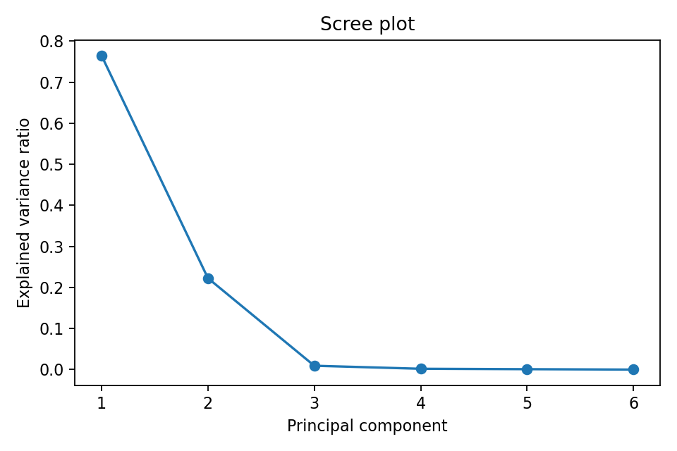
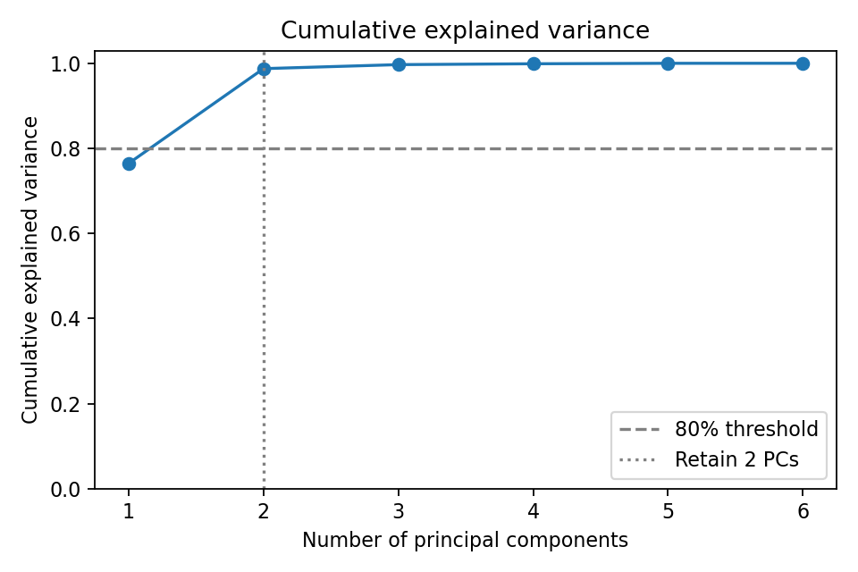
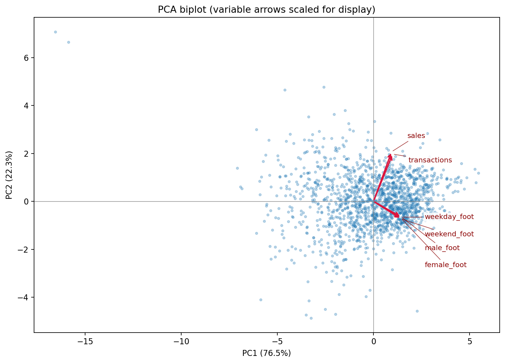

# Final Project 2 — Data Integration, Research Question Refinement & PCA

## Research question, audience, and potential use

**Research question:** What common patterns of floating population and estimated sales characterize Seoul commercial districts in 2025 Q1?

Combining mobility and commercial indicators allows the project to examine whether district-to-district variation is dominated by overall activity or by differences between floating population and estimated commercial activity. The question focuses on **patterns and contrasts**, not predictions of business performance or causal effects.

**Intended audience:** Seoul commercial-district analysts and prospective small-business owners. Analysts need a manageable way to compare districts across multiple correlated mobility and commercial indicators and identify districts that warrant closer examination. Prospective owners may want to understand how the mobility profile of a district compares with its estimated commercial activity before conducting more detailed location research.

**Potential use:** The retained PCA dimensions provide an exploratory summary for comparing district profiles and selecting districts for further investigation. For example, analysts can examine districts with different PC2 scores to investigate differences in mobility and commercial indicators; prospective owners can use such comparisons as a starting point for reviewing industry mix, location characteristics, and other information not captured here. PCA scores **do not rank business opportunities**, predict future sales, or establish that foot traffic causes sales.

## Data integration and preparation

### Sources, observation unit, and matching

The project uses two Seoul Open Data Plaza datasets: **서울시 상권분석서비스(길단위인구-상권)** (floating population) and **서울시 상권분석서비스(추정매출-상권)** (estimated sales). Source titles and access instructions appear in [README.md](README.md).

The original source data contain a reference-quarter code and a commercial-district code. The 2025 Q1 records were selected upstream. Floating population is represented once per district for the quarter, whereas estimated sales and transaction counts were **summed across industry categories** to produce one record per district. The resulting two input CSVs contain only 2025 Q1 records and **do not include a quarter column**. Accordingly, the notebook performs an **inner, one-to-one join on `district_code`**, after checking that the district code is unique in each input.

Each row of the integrated dataset represents **one Seoul commercial district in 2025 Q1**. The common district identifier and quarter restriction align the geographic and temporal units; the sales aggregation prevents an industry-level many-to-one merge from duplicating district observations.

| Integration stage | Number of districts |
|---|---:|
| Floating-population source, 2025 Q1, before restricting to matched districts | 1,650 |
| Estimated-sales source, 2025 Q1, after industry aggregation | 1,572 |
| Matched districts | 1,572 |
| Final integrated analysis rows | **1,572** |

All 1,572 sales districts have a floating-population match. The other **78 floating-population districts** are absent from the sales source and therefore outside the matched analysis. The supplied floating-population input CSV **already contains only the 1,572 matched districts**; the notebook's join does not remove those 78 records. This is a coverage/matching difference, **not missing-value deletion**. The integrated analysis dataset is available at [`data/analysis_2025Q1.csv`](data/analysis_2025Q1.csv).

### PCA inputs and preprocessing

| PCA input | Meaning |
|---|---|
| `weekday_foot` | Monday–Friday floating-population total |
| `weekend_foot` | Saturday–Sunday floating-population total |
| `male_foot` | Male floating-population total |
| `female_foot` | Female floating-population total |
| `sales` | Estimated sales summed across industries |
| `transactions` | Estimated transaction counts summed across industries |

The notebook checks these six variables for **missing, non-finite, and negative values** before PCA. In the supplied integrated data, no missing or negative PCA input values were found, so **no PCA rows were removed or imputed**. The district code is excluded because it is an identifier rather than a measured activity variable. No categorical variables are encoded for PCA.

All six indicators are nonnegative, but they differ in magnitude and measurement units: population and transaction counts versus estimated monetary sales. Each input is transformed with **`log1p`** to reduce right skew and then standardized to **zero mean and unit variance** using `StandardScaler`, so differences in original units do not mechanically dominate PCA.

The four floating-population measures are not independent: weekday/weekend and male/female counts are overlapping breakdowns of overall floating population. They are deliberately retained to summarize the correlated indicators, but this choice gives floating-population information multiple representations and affects the component coefficients. District size and industry mix are not included as adjustment variables, which also limits interpretation.

## PCA results and component selection

PCA was fitted to the six standardized, log-transformed variables. The explained variance ratio for **every component** is shown below (rounded to four decimal places in percent).

| Component | Explained variance ratio | Cumulative explained variance |
|---|---:|---:|
| PC1 | 76.4722% | 76.4722% |
| PC2 | 22.2707% | 98.7429% |
| PC3 | 0.9420% | 99.6850% |
| PC4 | 0.2043% | 99.8893% |
| PC5 | 0.1061% | 99.9954% |
| PC6 | 0.0046% | 100.0000% |

The project uses **80% cumulative explained variance** as an analysis choice, **not a professor-mandated cutoff**. PC1 alone falls below this threshold, while PC1 and PC2 together explain **98.74%**. The scree plot also shows a sharp decrease after PC2. Therefore, **two principal components are retained** for the exploratory summary.

### Scree plot

### Cumulative explained variance

### Component coefficients and interpretation

The table reports the **PCA eigenvector coefficients** from `pca.components_`, referred to as *loadings* in the course Demo 6. They are not variance-scaled correlation loadings. Component signs are arbitrary, so interpretation depends on **relative directions and magnitudes** rather than the sign alone.

| Variable | PC1 | PC2 |
|---|---:|---:|
| `weekday_foot` | 0.452 | -0.208 |
| `weekend_foot` | 0.448 | -0.229 |
| `male_foot` | 0.453 | -0.205 |
| `female_foot` | 0.450 | -0.222 |
| `sales` | 0.297 | 0.653 |
| `transactions` | 0.314 | 0.622 |

**PC1 — overall district activity:** All six coefficients are positive. The largest absolute coefficients are for the four floating-population variables (approximately 0.448–0.453), with smaller positive contributions from estimated sales and transactions. PC1 primarily summarizes the overall magnitude of district activity on the standardized log scale.

**PC2 — commercial activity versus floating population:** Estimated sales (0.653) and transactions (0.622) have the largest absolute coefficients, both positive. The four floating-population measures have smaller negative coefficients (approximately -0.205 to -0.229). PC2 therefore captures a relative contrast between estimated commercial activity and foot traffic, **not** a directly measured sales-conversion rate or business-success indicator.

### PC1–PC2 biplot and visible patterns

The biplot shows **district PCA scores** as points and **variable directions** as red arrows. The arrows are multiplied by a common factor for display; their lengths must not be interpreted in the score-axis units. Only the text labels are offset to avoid overlap; the arrow endpoints retain their calculated directions.

The four floating-population arrows point in nearly the same direction, consistent with their strong shared variation. The sales and transactions arrows also point in similar directions, but differ from the floating-population arrows primarily along PC2. The district scores are concentrated around the center with a wider spread toward negative PC1 and several more extreme observations. These patterns suggest variation in overall activity and in the balance of mobility and estimated commercial indicators. **The point cloud does not establish confirmed clusters.**

For the intended audience, these two axes provide a compact way to compare districts and identify unusual mobility-versus-sales profiles for closer investigation. They do not explain the causes of those differences or determine which district is best for a particular business.

## Conclusion and limitations

PCA summarizes six correlated floating-population and commercial indicators in two components explaining approximately **98.74%** of the standardized-log variation. PC1 primarily reflects overall district activity, while PC2 contrasts sales-related measures with floating population. This addresses the exploratory research question about common patterns across matched districts in 2025 Q1.

The analysis is limited to a single quarter and to districts present in both datasets. Sales and transaction counts are estimates, not independently observed business-level outcomes. Districts may differ in area, industry mix, and other characteristics not controlled for here. Overlapping floating-population variables, feature selection, logarithmic transformation, and standardization influence the PCA results. PCA does not establish causal relationships, predict outcomes, or confirm clusters.

## Reproducibility

Run [`Final_Project_2.ipynb`](Final_Project_2.ipynb) from the project root with [`data/floating_population_2025Q1.csv`](data/floating_population_2025Q1.csv) and [`data/estimated_sales_2025Q1.csv`](data/estimated_sales_2025Q1.csv). The notebook validates the join and PCA inputs, computes PCA and explained variance, and saves the three plots in `figures/`. Dependencies are listed in [`requirements.txt`](requirements.txt).

The input CSVs were already restricted and aggregated from the original Seoul Open Data Plaza XLSX datasets. **The notebook does not reproduce that upstream XLSX-to-CSV processing**, and it does not automatically regenerate every supplemental CSV, JSON, or NPZ artifact. The original source dataset names and access instructions are provided in the README.
